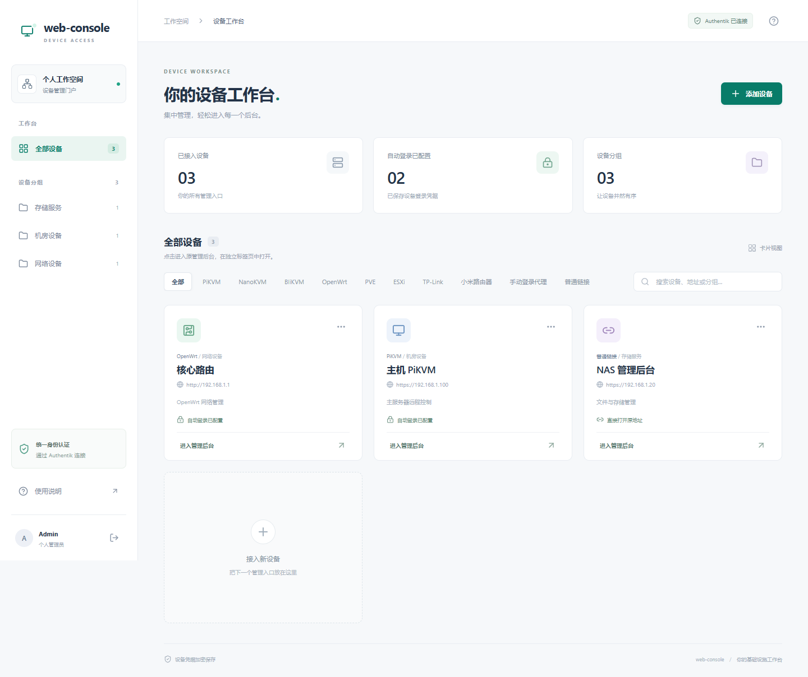

# web-console

<p align="center">
  <b>A modern, lightweight, secure portal for your personal devices</b>
</p>

<p align="center">
  <a href="README.md">简体中文</a> · English<br />
  <a href="https://github.com/Keviince/web-console/releases">Downloads</a> ·
  <a href="docs/deployment.md">Deployment guide</a> ·
  <a href="docs/devices.md">Device guide</a> ·
  <a href="LICENSE">MIT License</a>
</p>

---

`web-console` is a self-hosted device access portal built with **Go + React**. Sign in through **Authentik OIDC**, then find and open your KVMs, virtualization hosts, routers, and other web interfaces from one dashboard. For supported devices, the backend handles native authentication and opens the original management interface through a dedicated subdomain.

Built for personal homelabs and self-hosted setups, it brings scattered management URLs and logins into one place. Access is currently restricted to a single OIDC subject. The application interface is in Simplified Chinese.



## ✨ Features

- 🎯 **One device dashboard**: a responsive card layout with groups, device type filters, search, notes, and connection tests.
- 🔐 **OIDC sign-in**: authorization code flow with PKCE, validating token signatures, state, nonce, and the allowed personal subject.
- 🖥️ **Native quick login**: the backend authenticates supported KVMs, virtualization platforms, and routers using their existing credentials. Management interfaces open in separate tabs.
- 🌐 **Dedicated device subdomains**: isolated sessions and cookies for each device, with support for HTTP(S), WebSocket, MJPEG, uploads, and downloads.
- 🛡️ **Encrypted credential storage**: device credentials are encrypted with **AES-256-GCM** in **SQLite**. The encryption key is stored separately from the database, and the API never returns plaintext credentials.
- 🔗 **Flexible access to other services**: use a manual-login proxy to sign in through a device subdomain, or add a direct link to open the original URL.
- 📦 **Lightweight deployment**: Linux **amd64 / arm64** release archives and Docker images, a Go backend with no CGO dependency, and local data storage.

## 🧩 Supported devices

| Category | Devices / platforms | Access method |
| --- | --- | --- |
| KVM | PiKVM, NanoKVM, BliKVM, GL.iNet KVM | Native authentication, management interface and console proxying |
| Virtualization | Proxmox VE (PVE), VMware ESXi | Native tickets / sessions and management interface proxying |
| Networking | OpenWrt, TP-Link Chinese business SLP devices, Xiaomi routers | LuCI or device-native authentication protocols |
| Other web interfaces | Manual-login proxy | Dedicated subdomain with the original login flow |
| Any URL | Direct link | Open the original address in a new tab |

Compatibility depends on the model, firmware, and authentication protocol. For example, the ESXi adapter targets Host Client, the TP-Link adapter targets Chinese business SLP devices, and NanoKVM's older AES password protocol requires a separate adapter. CAPTCHAs or additional verification can be completed on the original login page. WebRTC media still requires the relevant network connectivity. See the [device guide](docs/devices.md) for details.

## 🚀 Quick start

### 1. Prepare your domains and Authentik

You will need:

- A portal domain, such as `console.example.com`.
- A wildcard device domain, such as `*.console.example.com`.
- An HTTPS certificate covering both the portal and device subdomains.
- A deployment host that can reach Authentik and your devices, plus a reverse proxy.

Forward both domains to the same backend on `:8080`, preserve `Host`, and enable WebSocket forwarding. A certificate for `*.example.com` does not cover `device.console.example.com`. See the [Nginx example](deploy/nginx.conf.example).

Create a confidential OAuth2/OIDC Provider in Authentik:

| Setting | Value |
| --- | --- |
| Redirect URI | `https://console.example.com/auth/callback`, with strict matching |
| Scope | `openid profile` |
| Issuer | The provider's actual discovery issuer |
| Access restriction | Set `OIDC_ALLOWED_SUB` to your stable subject |

Public-key signatures are supported, as is HS256 when no Signing Key is configured in Authentik. Do not assume that the subject is your username or email. See the [deployment guide](docs/deployment.md#authentik-subject-与排障) for subject discovery and authentication troubleshooting.

### 2. Deploy with Docker Compose

Clone the repository, or save `compose.yaml` and `.env.example` in the same directory. These commands assume Linux with Docker and Compose installed:

```bash
git clone https://github.com/Keviince/web-console.git
cd web-console
cp .env.example .env
mkdir -p secrets data
chmod 700 secrets data
```

Edit `.env` with your domains, `OIDC_ISSUER`, `OIDC_CLIENT_ID`, and `OIDC_ALLOWED_SUB`. Then pull the image and generate the encryption key for your first deployment:

```bash
docker compose pull
docker run --rm ghcr.io/keviince/web-console:latest -generate-key > secrets/encryption_key
```

Use a text editor to save your Authentik Client Secret in `secrets/oidc_client_secret`, then start the service:

```bash
chmod 600 secrets/encryption_key secrets/oidc_client_secret
docker compose up -d
docker compose ps
docker compose logs -f web-console
```

Open `https://console.example.com` and sign in with your Authentik account. If the public image is not yet available, use the source build below.

The image automatically selects `linux/amd64` or `linux/arm64` and runs as root (UID/GID 0) by default. Compose binds only to host address `127.0.0.1:8080` and stores data in the adjacent `./data` directory. If your reverse proxy runs on another host, set `BIND_ADDRESS` to a reachable LAN address and restrict access to that port. Existing named-volume installations should follow the [data migration guide](docs/deployment.md#数据与密钥) first.

<details>
<summary>Build a Docker image from source</summary>

Run from the repository root, using the directory and `.env` preparation steps above for a first deployment:

```bash
docker build --build-arg VERSION=v0.1.0 -t web-console:local .
docker run --rm web-console:local -generate-key > secrets/encryption_key
# After saving the Client Secret in secrets/oidc_client_secret:
chmod 600 secrets/encryption_key secrets/oidc_client_secret
docker compose -f compose.yaml -f compose.build.yaml up -d --build
```

Keep the original encryption key when updating an existing deployment.

</details>

<details>
<summary>Use a Linux release archive or an offline Docker image</summary>

Download `web-console_vX.Y.Z_linux_amd64.tar.gz` or `web-console_vX.Y.Z_linux_arm64.tar.gz` from [Releases](https://github.com/Keviince/web-console/releases), verify it against `checksums.txt`, and extract it. Each archive includes the executable, frontend assets, and deployment documentation. This example uses the `v0.1.0` amd64 archive; substitute your actual version:

```bash
cd web-console_v0.1.0_linux_amd64
cp .env.example .env
# Edit .env with your OIDC settings and domains.
mkdir -p secrets
chmod 700 secrets
./web-console -generate-key > secrets/encryption_key
# Save the Client Secret in secrets/oidc_client_secret.
chmod 600 secrets/encryption_key secrets/oidc_client_secret
set -a
. ./.env
set +a
export ENCRYPTION_KEY_FILE="$PWD/secrets/encryption_key"
export OIDC_CLIENT_SECRET_FILE="$PWD/secrets/oidc_client_secret"
./web-console
```

Run from the extracted directory so the default `web/dist` and `data` paths resolve correctly. For a persistent service, see the [systemd example](deploy/web-console.service.example).

For offline Docker deployment, download the matching `*.docker.tar.gz`, run `docker load -i <file>`, and set `WEBCONSOLE_IMAGE` in `.env` to the loaded tag, such as `web-console:v0.1.0-amd64` or `web-console:v0.1.0-arm64`. Generate the first deployment's key with that image, then follow the Compose startup steps above.

</details>

### 3. Add your devices

After signing in, click “添加设备” (Add device), select a type, and enter the device's internal URL, access subdomain, and existing credentials. Save it, run “测试连接” (Test connection), then click “进入管理后台” (Open management interface). The device interface opens in a new tab.

For self-signed HTTPS devices, import a trusted CA or pin the device certificate's SHA-256 fingerprint after verifying it. Other services can use the manual-login proxy or a direct link. See the [device guide](docs/devices.md) for URLs, entry paths, and firmware limitations.

## ⚙️ Configuration

| Environment variable | Description | Default |
| --- | --- | --- |
| `PORTAL_URL` | Portal HTTPS origin, without a path | Required |
| `DEVICE_DOMAIN` | Device subdomain suffix; may equal the portal hostname | Required |
| `OIDC_ISSUER` | Actual Authentik provider issuer | Required |
| `OIDC_CLIENT_ID` | OIDC Client ID | Required |
| `OIDC_ALLOWED_SUB` | The single personal subject allowed access | Required |
| `ENCRYPTION_KEY_FILE` | File containing a 64-character hexadecimal encryption key | `/run/secrets/encryption_key` |
| `OIDC_CLIENT_SECRET_FILE` | File containing the OIDC Client Secret | `/run/secrets/oidc_client_secret` |
| `LISTEN` | Backend listen address | `:8080` |
| `DATA_DIR` | SQLite data directory | `data` |
| `WEB_ROOT` | Production frontend asset directory | `web/dist` |
| `DEV_HTTP` | HTTP development mode for localhost / loopback addresses only | `false` |
| `WEBCONSOLE_IMAGE` | Image used by Compose | `ghcr.io/keviince/web-console:latest` |
| `BIND_ADDRESS` | Host address for the Compose port binding | `127.0.0.1` |
| `HOST_PORT` | Host port published by Compose | `8080` |
| `GO_MODULE_PROXY` | Go module proxy for Docker source builds | `https://proxy.golang.org,direct` |

Compose reads `.env` automatically. When running the binary directly, export the variables yourself. **Keep offline backups of the database and its original encryption key. Lost keys make stored device credentials unrecoverable.** See the [deployment guide](docs/deployment.md) for backups, migration, reverse proxies, and troubleshooting.

## 🔒 Security and compatibility

- **Portal access control**: sessions last 8 hours by default, cookies are host-only, and write requests require Origin and CSRF validation.
- **Device session management**: credentials are decrypted and used on the backend. Signing out of the portal revokes associated proxy access and closes long-lived connections. Authentik manages its global SSO session separately.
- **Request recovery**: only allowed read requests are retried automatically when a device session expires. Uploads, configuration changes, reboots, and power operations are never automatically replayed.
- **TLS verification**: certificate chains and hostnames are verified by default. Certificate pinning also checks validity dates by default; an optional per-device setting can ignore those dates while still enforcing the exact fingerprint.
- **Firmware compatibility**: devices retain their original authentication methods. Firmware variants, MFA, and media transport need validation in your actual environment.
- **Data migration**: the database uses `webconsole.db` and also supports the legacy `webcontrol.db` filename. Preserve existing data and keys during upgrades.

## 🛠️ Local development

Requires **Go 1.26** and **Node.js 22**.

```bash
go mod download
go vet ./...
go test ./... -count=1
cd web
npm ci
npm run build
npx playwright install chromium
npm test
```

## 📚 Documentation

The detailed guides are currently in Simplified Chinese:

- [Deployment and maintenance](docs/deployment.md): domains, HTTPS, Authentik, backups, migration, and local development.
- [Device integration](docs/devices.md): authentication protocols, default entry paths, certificates, and compatibility limits.

## 📄 License

Released under the [MIT License](LICENSE).
