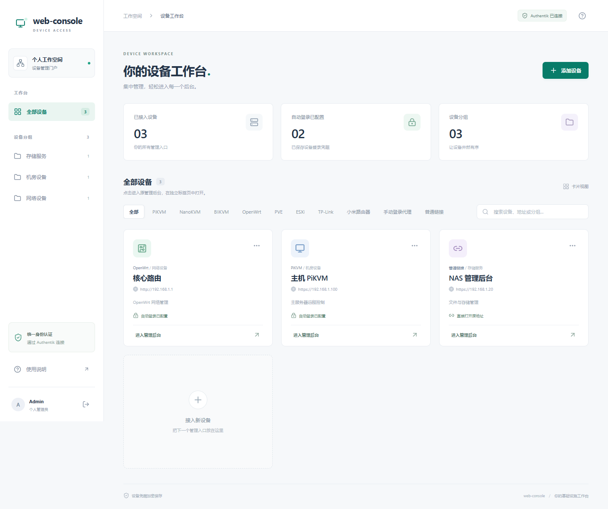

# web-console

<p align="center">
  <b>现代、轻量、安全的个人设备管理门户</b>
</p>

<p align="center">
  简体中文 · <a href="README.en.md">English</a><br />
  <a href="https://github.com/Keviince/web-console/releases">下载</a> ·
  <a href="docs/deployment.md">部署指南</a> ·
  <a href="docs/devices.md">设备接入</a> ·
  <a href="LICENSE">MIT License</a>
</p>

---

`web-console` 是一个使用 **Go + React** 构建的自托管设备管理门户。通过 **Authentik OIDC** 登录后，你可以在同一个工作台检索并访问 KVM、虚拟化主机、路由器及其他 Web 后台。支持的设备由后端完成原生认证，再通过独立子域名打开原有管理界面。

它面向个人 Homelab 和自托管环境：把分散的管理地址与登录入口集中起来，让日常维护从一个页面开始。当前访问控制以单个 OIDC subject 为边界，界面为简体中文。



## ✨ 核心特性

- 🎯 **统一设备工作台**：响应式卡片界面，支持设备分组、类型筛选、搜索、备注及连接测试。
- 🔐 **OIDC 统一登录**：使用授权码流程与 PKCE，校验令牌签名、state、nonce 和允许访问的个人 subject。
- 🖥️ **设备原生快速登录**：支持多种 KVM、虚拟化平台与路由器，由后端使用设备原有账号密码完成认证，管理界面在独立标签页打开。
- 🌐 **独立子域名代理**：按设备隔离会话与 Cookie，支持 HTTP(S)、WebSocket、MJPEG、文件上传及下载。
- 🛡️ **加密凭据存储**：设备凭据使用 **AES-256-GCM** 加密后保存到 **SQLite**，加密密钥与数据库分开保存，API 不返回明文凭据。
- 🔗 **灵活接入其他后台**：可选择「手动登录代理」，通过子域名访问并自行登录；也可添加「普通链接」，直接打开原地址。
- 📦 **轻量部署与分发**：提供 Linux **amd64 / arm64** 安装包及 Docker 镜像；Go 后端无需 CGO，数据保存在本地目录。

## 🧩 支持的设备

| 类别 | 设备 / 平台 | 接入方式 |
| --- | --- | --- |
| KVM | PiKVM、NanoKVM、BliKVM、GL.iNet KVM | 原生认证、管理页面与控制台代理 |
| 虚拟化 | Proxmox VE（PVE）、VMware ESXi | 原生票据 / 会话与管理页面代理 |
| 路由与网络 | OpenWrt、TP-Link 国内商用 SLP、小米路由器 | LuCI 或设备原生认证协议 |
| 其他 Web 后台 | 手动登录代理 | 独立子域名访问，保留原页面登录流程 |
| 任意网址 | 普通链接 | 直接在新标签页打开 |

支持范围取决于设备型号、固件与认证协议。例如，ESXi 适配面向 Host Client，TP-Link 适配面向国内商用 SLP；NanoKVM 的旧 AES 密码协议需另行适配。验证码或二次验证可通过原页面手动完成，WebRTC 媒体仍需要相应网络可达。完整说明见 [设备接入](docs/devices.md)。

## 🚀 快速开始

### 1. 准备域名与 Authentik

准备以下内容：

- 门户域名，例如 `console.example.com`。
- 设备通配域名，例如 `*.console.example.com`。
- 同时覆盖门户与设备子域名的 HTTPS 证书。
- 能访问 Authentik 和设备内网的部署主机，以及反向代理。

将门户和设备域名转发到同一个后端 `:8080`，保留 `Host`，并启用 WebSocket 转发。注意：`*.example.com` 无法覆盖 `device.console.example.com`。可参考 [Nginx 配置示例](deploy/nginx.conf.example)。

在 Authentik 中创建 confidential OAuth2/OIDC Provider：

| 配置项 | 设置 |
| --- | --- |
| Redirect URI | `https://console.example.com/auth/callback`，严格匹配 |
| Scope | `openid profile` |
| Issuer | Provider 的实际 discovery issuer |
| 访问限制 | 将你的稳定 subject 填入 `OIDC_ALLOWED_SUB` |

支持公钥签名，以及 Authentik 未配置 Signing Key 时的 HS256。subject 不能直接假定为用户名或邮箱；获取方法及认证排障见 [部署指南](docs/deployment.md#authentik-subject-与排障)。

### 2. 使用 Docker Compose 部署

克隆仓库，或将 `compose.yaml` 和 `.env.example` 保存到同一目录。以下命令面向 Linux，需已安装 Docker 和 Compose：

```bash
git clone https://github.com/Keviince/web-console.git
cd web-console
cp .env.example .env
mkdir -p secrets data
chmod 700 secrets data
```

编辑 `.env`，填写域名、`OIDC_ISSUER`、`OIDC_CLIENT_ID` 和 `OIDC_ALLOWED_SUB`。然后拉取镜像并生成首次部署的加密密钥：

```bash
docker compose pull
docker run --rm ghcr.io/keviince/web-console:latest -generate-key > secrets/encryption_key
```

使用文本编辑器将 Authentik Client Secret 写入 `secrets/oidc_client_secret`，再启动：

```bash
chmod 600 secrets/encryption_key secrets/oidc_client_secret
docker compose up -d
docker compose ps
docker compose logs -f web-console
```

打开 `https://console.example.com`，使用你的 Authentik 账号登录。若公开镜像尚不可用，可使用下方的源码构建方式。

镜像自动匹配 `linux/amd64` / `linux/arm64`，默认以 root（UID/GID 0）运行。Compose 仅映射宿主机 `127.0.0.1:8080`，数据保存在旁边的 `./data` 目录。反向代理在其他主机上时，请将 `BIND_ADDRESS` 改为代理可达的 LAN 地址，并限制该端口的访问来源。已有命名卷部署请先按 [数据与密钥](docs/deployment.md#数据与密钥) 迁移。

<details>
<summary>从源码构建 Docker 镜像</summary>

在仓库根目录运行，首次部署时沿用上面的目录与 `.env` 准备步骤：

```bash
docker build --build-arg VERSION=v0.1.0 -t web-console:local .
docker run --rm web-console:local -generate-key > secrets/encryption_key
# 将 Client Secret 写入 secrets/oidc_client_secret 后：
chmod 600 secrets/encryption_key secrets/oidc_client_secret
docker compose -f compose.yaml -f compose.build.yaml up -d --build
```

已有部署请保留原加密密钥。

</details>

<details>
<summary>使用 Linux 安装包或离线 Docker 镜像</summary>

从 [Releases](https://github.com/Keviince/web-console/releases) 下载对应架构的 `web-console_vX.Y.Z_linux_amd64.tar.gz` 或 `web-console_vX.Y.Z_linux_arm64.tar.gz`，校验 `checksums.txt` 后解压。安装包包含程序、前端静态资源和部署文档。以下以 `v0.1.0` 的 amd64 包为例，请替换为实际版本：

```bash
cd web-console_v0.1.0_linux_amd64
cp .env.example .env
# 编辑 .env，填写 OIDC 和域名配置。
mkdir -p secrets
chmod 700 secrets
./web-console -generate-key > secrets/encryption_key
# 将 Client Secret 写入 secrets/oidc_client_secret。
chmod 600 secrets/encryption_key secrets/oidc_client_secret
set -a
. ./.env
set +a
export ENCRYPTION_KEY_FILE="$PWD/secrets/encryption_key"
export OIDC_CLIENT_SECRET_FILE="$PWD/secrets/oidc_client_secret"
./web-console
```

请从解压目录运行，以便默认的 `web/dist` 和 `data` 路径生效。长期运行可参考 [systemd 服务示例](deploy/web-console.service.example)。

离线 Docker 部署可下载对应架构的 `*.docker.tar.gz`，执行 `docker load -i <文件>`，将 `.env` 中的 `WEBCONSOLE_IMAGE` 改为载入的标签，例如 `web-console:v0.1.0-amd64` 或 `web-console:v0.1.0-arm64`。使用该镜像生成首次部署的密钥后，按上述 Compose 步骤启动。

</details>

### 3. 接入你的设备

登录后点击「添加设备」，选择类型并填写设备内网地址、访问子域名和原有凭据。保存后执行「测试连接」，再点击「进入管理后台」。设备管理页面会在新标签页打开。

自签名 HTTPS 设备可导入可信 CA，或在核对后固定设备证书的 SHA-256 指纹。其他后台可使用手动登录代理或普通链接。各类型的地址、入口和固件限制见 [设备接入](docs/devices.md)。

## ⚙️ 配置项

| 环境变量 | 说明 | 默认值 |
| --- | --- | --- |
| `PORTAL_URL` | 门户 HTTPS origin，不带路径 | 必填 |
| `DEVICE_DOMAIN` | 设备子域名后缀，可等于门户主机名 | 必填 |
| `OIDC_ISSUER` | Authentik Provider 实际 issuer | 必填 |
| `OIDC_CLIENT_ID` | OIDC Client ID | 必填 |
| `OIDC_ALLOWED_SUB` | 唯一允许访问的个人 subject | 必填 |
| `ENCRYPTION_KEY_FILE` | 保存 64 位十六进制加密密钥的文件路径 | `/run/secrets/encryption_key` |
| `OIDC_CLIENT_SECRET_FILE` | 保存 OIDC Client Secret 的文件路径 | `/run/secrets/oidc_client_secret` |
| `LISTEN` | 后端监听地址 | `:8080` |
| `DATA_DIR` | SQLite 数据目录 | `data` |
| `WEB_ROOT` | 前端生产资源目录 | `web/dist` |
| `DEV_HTTP` | 仅用于 localhost / 回环地址的 HTTP 开发 | `false` |
| `WEBCONSOLE_IMAGE` | Compose 使用的镜像 | `ghcr.io/keviince/web-console:latest` |
| `BIND_ADDRESS` | Compose 映射端口的宿主机地址 | `127.0.0.1` |
| `HOST_PORT` | Compose 映射的宿主机端口 | `8080` |
| `GO_MODULE_PROXY` | Docker 源码构建时使用的 Go 模块代理 | `https://proxy.golang.org,direct` |

Compose 自动读取 `.env`；直接运行二进制时需自行导出环境变量。**请离线备份数据库与原加密密钥；丢失密钥将无法解密已保存的设备凭据。** 备份、迁移、反向代理和排障见 [部署指南](docs/deployment.md)。

## 🔒 安全与兼容

- **门户访问控制**：默认会话有效期为 8 小时，Cookie 限定单主机，写操作要求 Origin 与 CSRF 校验。
- **设备会话管理**：设备凭据在后端解密并用于认证；退出门户会撤销关联的代理访问并关闭长连接。Authentik 全局 SSO 会话仍由 Authentik 管理。
- **请求恢复边界**：设备会话失效时仅自动重试允许的读取请求；上传、配置、重启及电源操作不会自动重放。
- **TLS 验证**：默认校验证书链与主机名。固定指纹模式也默认检查有效期；可按设备开启「忽略证书有效期」，仍严格匹配指纹。
- **固件兼容性**：设备保留原始认证方式；不同固件、MFA 和媒体传输能力需按实际环境验证。
- **数据迁移**：数据库使用 `webconsole.db`，并兼容旧 `webcontrol.db`；升级时保留原数据与密钥。

## 🛠️ 本地开发

需要 **Go 1.26** 和 **Node.js 22**。

```bash
go mod download
go vet ./...
go test ./... -count=1
cd web
npm ci
npm run build
npx playwright install chromium
npm test
```

## 📚 文档

- [部署与维护](docs/deployment.md)：域名、HTTPS、Authentik、备份、迁移与本地开发。
- [设备接入](docs/devices.md)：认证协议、默认入口、证书配置与兼容边界。

## 📄 开源许可证

本项目基于 [MIT 许可证](LICENSE) 开源。
