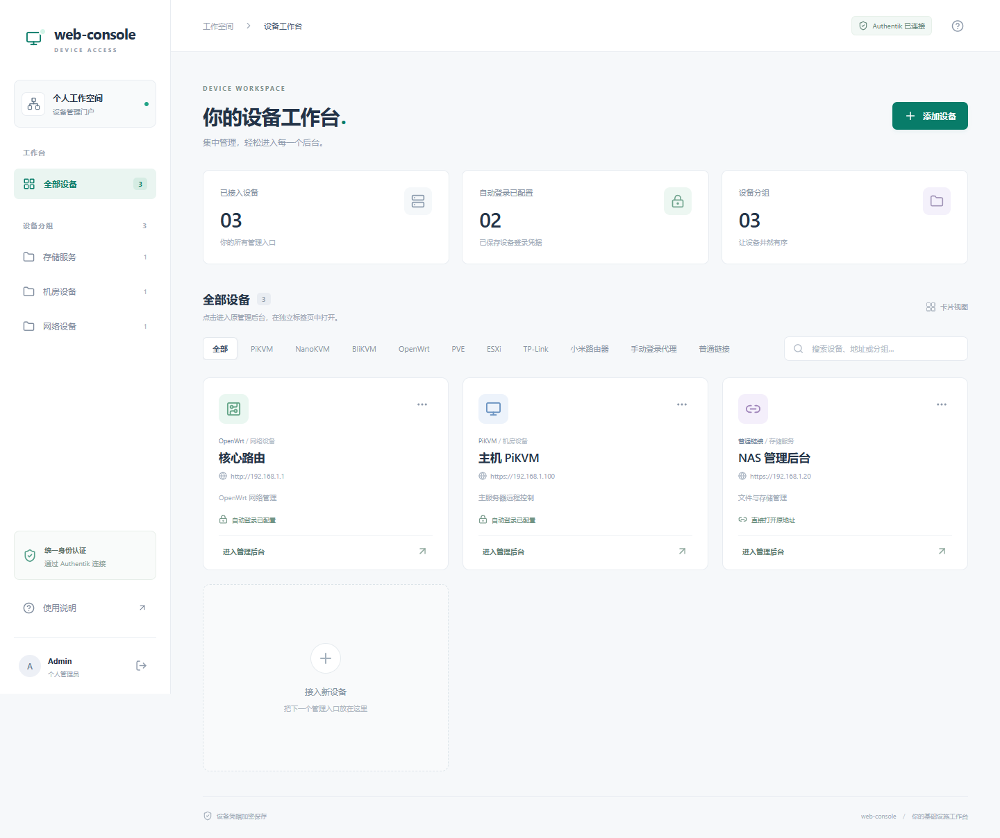

# web-console

<p align="center">
  <b>现代、轻量、安全的个人设备管理门户</b>
</p>

---

`web-console` 使用 Go + React 构建，通过 Authentik OIDC 统一登录，集中管理 KVM、虚拟化主机、路由器及其他 Web 后台。设备在独立标签页打开，保留原有管理界面与认证协议。



## ✨ 核心特性

- 🎯 **设备工作台**：中文响应式界面，支持分组、搜索、备注及连接测试。
- 🔐 **统一身份认证**：OIDC 授权码 + PKCE，校验签名、state、nonce 与允许访问的个人 subject。
- 🖥️ **原生快速登录**：支持 PiKVM、NanoKVM、BliKVM、GL.iNet KVM、OpenWrt、PVE、ESXi、TP-Link 国内 SLP 及小米路由器。
- 🌐 **独立子域名代理**：每台设备隔离会话和 Cookie，支持 HTTP(S)、WebSocket、MJPEG、上传及下载。
- 🛡️ **加密凭据存储**：AES-256-GCM + SQLite；加密密钥与数据库分开保存。
- 🔗 **通用接入**：其他后台可选择「手动登录代理」或「普通链接」。
- 📦 **多架构分发**：Linux amd64 / arm64 安装包与 Docker 镜像，后端无需 CGO。

## 🚀 快速开始

### 1. 配置域名与 Authentik

准备门户域名 `console.example.com`、设备通配域名 `*.console.example.com`，将两者转发到同一后端 `:8080`，保留 `Host` 并启用 HTTPS。证书须同时覆盖门户本身和设备子域名；参考 [Nginx 配置](deploy/nginx.conf.example)。

在 Authentik 创建 confidential OAuth2/OIDC Provider：

- Redirect URI：`https://console.example.com/auth/callback`，严格匹配。
- Scope：`openid profile`。
- 将实际 issuer、Client ID、个人稳定 subject 写入 `.env`。
- 将 Client Secret 写入 `secrets/oidc_client_secret`。

支持公钥签名，以及 Authentik 未配置 Signing Key 时的 HS256。subject 不能直接假定为用户名或邮箱；获取方法及认证诊断见 [部署指南](docs/deployment.md)。

### 2. Docker 部署

从仓库复制 `compose.yaml` 和 `.env.example`，或下载完整源码：

```bash
cp .env.example .env
# 编辑 .env 中的域名、OIDC_ISSUER、OIDC_CLIENT_ID、OIDC_ALLOWED_SUB。
mkdir -p secrets data
chmod 700 secrets data
# 首次发布 GHCR 镜像后可直接拉取；本地构建方式见下文。
docker compose pull
docker run --rm ghcr.io/keviince/web-console:latest -generate-key > secrets/encryption_key
# 使用文本编辑器将 Authentik Client Secret 写入 secrets/oidc_client_secret。
chmod 600 secrets/encryption_key secrets/oidc_client_secret
docker compose up -d
docker compose ps
```

镜像自动匹配 `linux/amd64` / `linux/arm64`，以 root（UID/GID 0）运行，默认只映射宿主机 `127.0.0.1:8080`。数据通过目录挂载保存在 Compose 文件旁的 `./data`，无需创建命名卷或设置 UID 10001。反向代理位于其他主机时，请将 `BIND_ADDRESS` 改为可达的 LAN 地址并配置访问限制。已有命名卷部署需先按 [部署指南](docs/deployment.md#数据与密钥) 迁移数据，再使用新配置启动。

**从源码构建：**

```bash
docker build --build-arg VERSION=v0.1.0 -t web-console:local .
# 可在填写 OIDC 配置前运行上面的构建命令。
docker run --rm web-console:local -generate-key > secrets/encryption_key
# 配置好 .env 与两个 secret 文件后：
docker compose -f compose.yaml -f compose.build.yaml up -d --build
```

**离线镜像：** 下载对应架构的 `*.docker.tar.gz`，执行 `docker load -i <文件>`，将 `.env` 中的 `WEBCONSOLE_IMAGE` 改为载入的 `web-console:v0.1.0-amd64` 或 `web-console:v0.1.0-arm64`，然后用该镜像生成密钥并启动 Compose。

### 3. Linux 安装包

从 [Releases](https://github.com/Keviince/web-console/releases) 下载 `web-console_vX.Y.Z_linux_amd64.tar.gz` 或 `web-console_vX.Y.Z_linux_arm64.tar.gz`，校验 `checksums.txt` 后解压。安装包包含程序、前端静态资源及部署文档。

```bash
cd web-console_v0.1.0_linux_amd64
cp .env.example .env
# 编辑 .env 的 OIDC 和域名配置。
mkdir -p secrets
chmod 700 secrets
./web-console -generate-key > secrets/encryption_key
# 编辑 secrets/oidc_client_secret，填入 Authentik Client Secret。
chmod 600 secrets/*
set -a
. ./.env
set +a
export ENCRYPTION_KEY_FILE="$PWD/secrets/encryption_key"
export OIDC_CLIENT_SECRET_FILE="$PWD/secrets/oidc_client_secret"
./web-console
```

请从解压目录运行，以便默认的 `web/dist` 与 `data` 相对路径生效。长期运行可参考 [systemd 示例](deploy/web-console.service.example)。

### 4. 接入设备

登录门户后添加设备，选择类型、内网地址、子域名及原有凭据，保存并执行「测试连接」，然后进入管理后台。自签名设备应导入可信 CA，或在核对后固定设备证书 SHA-256 指纹。

设备类型及固件兼容边界见 [设备接入](docs/devices.md)。验证码或二次验证可切换到原页面手动登录；WebRTC 仍需要设备媒体网络可达。

## ⚙️ 配置

| 变量 | 说明 | 默认值 |
| --- | --- | --- |
| `PORTAL_URL` | 门户 HTTPS origin | 必填 |
| `DEVICE_DOMAIN` | 设备子域名后缀，可等于门户主机名 | 必填 |
| `OIDC_ISSUER` | Authentik provider 实际 issuer | 必填 |
| `OIDC_CLIENT_ID` | OIDC Client ID | 必填 |
| `OIDC_ALLOWED_SUB` | 唯一允许访问的个人 subject | 必填 |
| `ENCRYPTION_KEY_FILE` | 64 位十六进制加密密钥文件 | `/run/secrets/encryption_key` |
| `OIDC_CLIENT_SECRET_FILE` | OIDC secret 文件 | `/run/secrets/oidc_client_secret` |
| `LISTEN` | 后端监听地址 | `:8080` |
| `DATA_DIR` | SQLite 数据目录 | `data` |
| `WEB_ROOT` | 前端生产资源目录 | `web/dist` |
| `DEV_HTTP` | 仅用于 localhost / 回环地址的 HTTP 开发 | `false` |
| `WEBCONSOLE_IMAGE` | Compose 镜像 | `ghcr.io/keviince/web-console:latest` |

程序直接启动时需要自行导出环境变量；Compose 自动读取 `.env`。请离线备份数据库与原加密密钥，丢失密钥将无法解密已保存的设备凭据。备份、迁移、反向代理和排障见 [部署指南](docs/deployment.md)。

## 🛠️ 开发与构建

需要 Go 1.26、Node.js 22；打包脚本额外使用 Python 3.10+。

```bash
go mod download
go vet ./...
go test ./... -count=1
cd web
npm ci
npm run build
npx playwright install chromium
npm test
cd ..
python scripts/release.py --version v0.1.0
```

产物位于 `dist/v0.1.0/`，包括两种架构的安装包、干净源码 ZIP 与 SHA-256 校验文件。源码 ZIP 排除 `.env`、密钥、数据库、缓存、编译产物和本地部署记录。

多架构镜像构建与推送：

```bash
docker buildx build --platform linux/amd64,linux/arm64 \
  --build-arg VERSION=v0.1.0 -t ghcr.io/keviince/web-console:0.1.0 --push .
```

GitHub Actions 在提交时执行检查；推送 `v*` 标签后自动创建 Release，上传双架构安装包，并向 GHCR 发布双架构镜像。首次使用需启用 Actions，允许工作流写入仓库和 Packages；公开仓库的 GHCR 包还需设为 Public。完整流程见 [发布指南](docs/releasing.md)。

## 🔒 安全与兼容

- 门户会话默认 8 小时，Cookie 限定单主机；写操作要求 Origin 与 CSRF 校验。
- 设备认证在后端进行，不向 API 返回明文凭据；门户退出撤销关联设备访问与长连接。
- 自动恢复仅重试允许的读取请求；上传、配置、重启和电源操作不会自动重放。
- TLS 默认校验证书；固定证书指纹模式默认检查有效期，可按设备开启「忽略证书有效期」，仍严格匹配指纹。
- 数据库保留 `webconsole.db` 文件名，并兼容旧 `webcontrol.db`，便于已有数据迁移。
- 各设备仍保留原始认证；不同固件及视频功能需按实际环境验证。

## 📄 开源许可证

本项目基于 [MIT 许可证](LICENSE) 开源。
